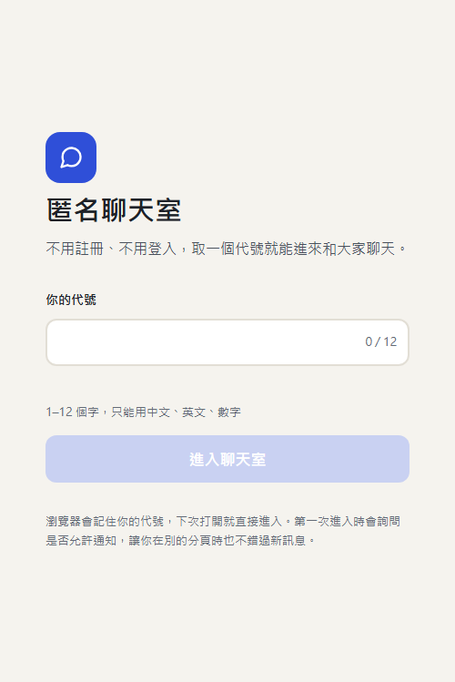
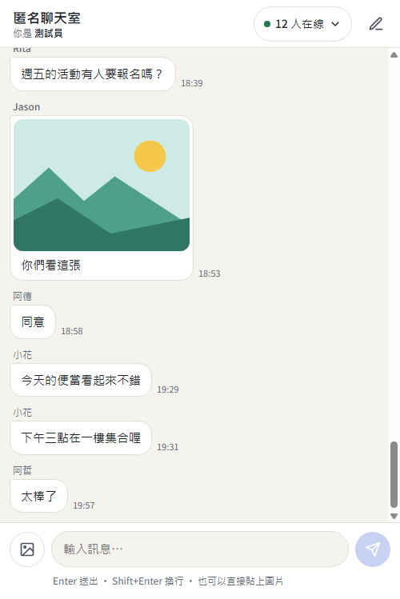
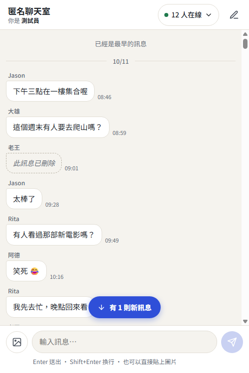
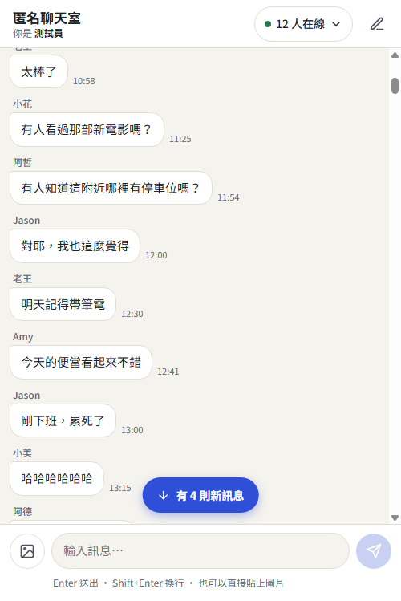
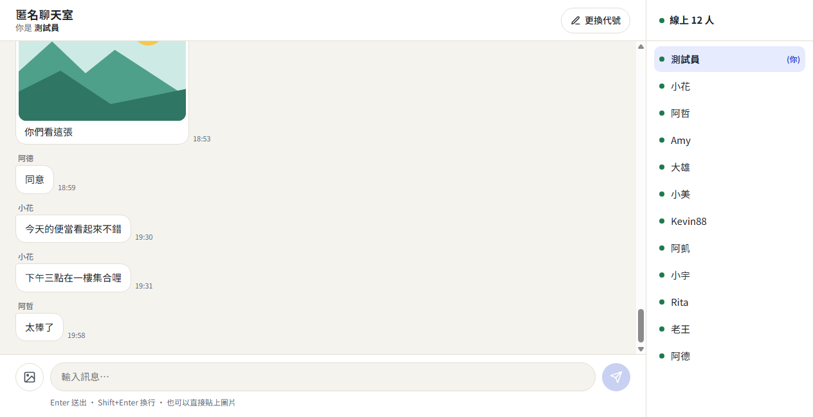

# 匿名聊天室

一個不用註冊、不用登入的匿名聊天室。所有人在同一間,電腦和手機都能用。

- **線上網址**:https://rowan0629.github.io/20261013/
- **前端**:React + TypeScript + Vite,放在 GitHub Pages
- **後端**:Supabase(匿名登入、資料庫、即時推送、圖片倉庫)
- **文件**:[需求](docs/requirements.md)・[架構](docs/architecture.md)・[畫面設計](docs/design.md)

## 新增功能(已完成)

下表每一項都標明「怎麼自己看到」和「我怎麼驗證的」。驗證分兩種環境:
**真實後端**是對真實的 Supabase 專案測試;**模擬器**是對階段一的模擬器版測試(它有 200 則假的歷史訊息,方便測往上載入)。
沒有驗證到的部分,寫在「限制」欄。

| 功能 | 怎麼自己看到 | 驗證 | 限制 |
|---|---|---|---|
| **傳圖片(Storage)**<br>選圖或貼上,5 MB 內,JPG / PNG / GIF / WebP,上傳到 Supabase 的 `chat-images` 倉庫 | 輸入區左邊的圖片鈕,選圖後有預覽,可移除,再按送出 | 真實後端:傳送後對方畫面真的載入圖片(不是破圖);倉庫會擋 SVG、擋超過 5 MB、擋上傳到別人的資料夾;傳到自己資料夾的圖片可以刪除 | 倉庫只檢查上傳時宣告的檔案類型,不看檔案內容(見[架構 9.3](docs/architecture.md)) |
| **資料庫頻率限制**<br>同一個人 10 秒內最多 5 則 | 連續快速送 6 則,第 6 則會被擋 | 真實後端:直接呼叫資料庫函式,第 6 則被拒絕並回傳 `rate_limited`。這是在資料庫裡擋的,繞過畫面也沒用 | 畫面上「送太快了」的提示文字走同一個錯誤對應表,但我**沒有**另外在瀏覽器裡實測過這行字出現 |
| **編輯與刪除訊息**<br>只能改刪自己的 | 點自己的訊息(手機)或滑過去(電腦),出現「編輯」「刪除」。編輯後顯示「(已編輯)」;刪除前會確認,刪除後顯示「此訊息已刪除」 | 真實後端(兩個隔離的身分):A 編輯後 B 即時看到新內容與「(已編輯)」;A 刪除後 B 看到「此訊息已刪除」且原內容消失;B 編輯、刪除 A 的訊息被資料庫拒絕 | 電腦版「滑過才出現按鈕」的 hover 行為沒有自動化測過,只測了手機的點選 |
| **未讀數與桌面通知** | 切到別的分頁或視窗,有人說話時,分頁標題變成 `(N) 匿名聊天室`,並跳出桌面通知;回到畫面就歸零。第一次進入時瀏覽器會詢問是否允許通知 | 模擬器:不在畫面上時標題變 `(1) 匿名聊天室`;通知被呼叫一次,內容是「發送者:訊息」;回到畫面後標題恢復 | 通知的呼叫是用替身驗證的,**沒有**驗證真的有彈出作業系統的通知視窗;「允許通知」的詢問視窗也沒有測 |
| **圖片檢視與下載** | 點聊天室裡的圖片,全螢幕放大,有關閉鈕和下載鈕 | 模擬器:點圖片開啟、圖片真的載入、有關閉鈕和下載連結、按 Esc 關閉、點圖片外的空白處關閉。手機與電腦版面各測一次 | 只驗證了下載連結指向圖片本身,**沒有**實際觸發下載動作、確認檔案存到電腦 |
| **往上載入歷史** | 往上滑到頂端,自動載入更早的訊息,畫面不跳;一直載到最早會顯示「已經是最早的訊息」;日期改變處有分隔線 | 模擬器:一開始載入最新 50 則;捲到頂端載入到 100 則,畫面保留原本的位置,沒有跳回最頂;連續載到最早共 201 則並顯示「已經是最早的訊息」;有日期分隔線。往上滑時來了新訊息,畫面不動,出現「有 N 則新訊息」按鈕,點了跳到最底。手機與電腦各測一次 | 真實後端目前只有少量訊息,**沒有**用超過 50 則的真實資料測過往上載入(分頁的查詢方式有寫,但沒實測) |

其他一併完成的基本功能:輸入代號(重複被擋、記住上次的代號)、即時收發、線上名單與進出提示、斷線橫幅與重連後補上漏掉的訊息、訊息一律當純文字顯示(不會執行訊息裡的程式碼)。

### 畫面截圖

截圖來自**模擬器版**(所以名單和對話是假的),用來看畫面;真實後端的行為見上表。

| 輸入代號 | 聊天室 | 往上載入歷史 | 有新訊息 | 圖片檢視 |
|---|---|---|---|---|
|  |  |  |  |  |

電腦版(右側固定線上名單):



## 驗證結果

2026-10-13 各項測試最近一次的結果(每一項都是在對應程式最後一次修改後執行的)。測試腳本沒有放進這個 repo,只是在開發過程中用 Chrome 的遠端控制介面執行。

| 測什麼 | 結果 |
|---|---|
| 真實後端、兩個隔離的身分的完整流程(進入、代號重複被擋、在線人數、收發、編輯、刪除、傳圖片、斷線重連補資料、離開後代號釋放) | 24 / 24 |
| 模擬器的畫面行為(往上載入、新訊息按鈕、圖片檢視與下載、未讀數與通知),手機尺寸與電腦尺寸各一次 | 19 / 19,19 / 19 |
| 資料庫規則(只用公開金鑰從外面打:代號、頻率、只能改自己的、直接寫入被擋、圖片倉庫規則) | 31 / 32。沒過的那一項是我的測試寫法問題:刪除圖片後,公開網址有快取,馬上重讀還是讀得到;圖片本身確認已刪除 |
| 換代號時,新代號被占用,舊代號保留(含兩人同時搶同一個代號) | 9 / 9 |
| 收到訊息時的檢查(丟掉格式不合的訊息,見[架構 9.5](docs/architecture.md)) | 29 / 29 |
| 有人離開後,別人的線上名單多久更新 | 關閉分頁 / 離開網頁 / 按「更換代號」:約 3–4 秒。**網路突然斷掉:約 64–67 秒**(由 Supabase 即時伺服器的逾時決定) |

## 本機執行

```
npm install
npm run dev        # 開發預覽，網址會顯示在終端機
npm run build      # 型別檢查 + 建置
```

- 想用**模擬器**(假的人與歷史訊息,不連網路):設定環境變數 `VITE_BACKEND=mock`,並在網址後面加 `?debug` 會出現遙控面板(模擬斷線、讓假人說話、進出)。
- 想連**真實的 Supabase**:複製 `.env.example` 為 `.env.local`,填入 `VITE_BACKEND=supabase`、`VITE_SUPABASE_URL`、`VITE_SUPABASE_PUBLISHABLE_KEY`。這兩個值都是可公開的;`.env.local` 不會進 git。**不要**放 Secret key 或資料庫密碼。
- 資料庫的建立方式見 [`supabase/migrations/`](supabase/migrations) 與[架構 5.6](docs/architecture.md):把 SQL 檔依檔名順序貼到 Supabase 後台的 SQL Editor 執行。

## 已知限制

完整清單見[架構文件第 9、10 節](docs/architecture.md)。最重要的:

- **沒有登入,所以「是誰」只認這個瀏覽器。** 換瀏覽器或清掉網站資料,就變成另一個人。
- **沒有管理員功能。** 聊天室是公開的,知道網址的人都能發言;不當內容只能進 Supabase 後台手動刪除。
- **線上名單可被沒登入的人偽造**(訊息、代號、圖片都擋得住,只有名單沒有)。
- 免費方案有容量、連線數與閒置暫停的限制。
