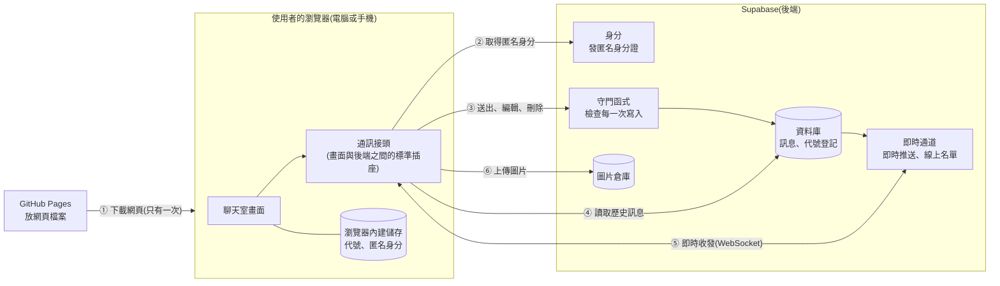
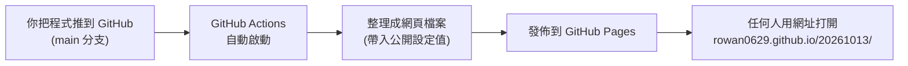

# 匿名聊天室 架構文件

> 這份文件寫給「不寫程式的專案負責人」看。
> 專有名詞第一次出現時,會用一句話解釋。畫面的顏色與樣式不在這裡決定,那是 `/design` 的工作。

---

## 1. 專案說明與目標

### 這是什麼

一個不用註冊、不用登入的匿名聊天室。所有人都在同一間。只要知道網站連結,用電腦或手機都能進來聊天。

### 使用者會經歷什麼

1. 打開網頁
2. 輸入一個代號(1–12 個字,只能用中文、英文、數字)
3. 進入聊天室,看到所有歷史訊息,也可以送出文字、emoji、圖片
4. 看得到誰在線上,有人進出時會有短暫提示
5. 可以編輯或刪除**自己**送出的訊息

### 目標

- 好用:手機和電腦都順手,斷線會自己重連並補上漏掉的訊息。
- 安全:別人不能改你的訊息,也不能用奇怪的內容弄壞聊天室。
- 便宜:不租伺服器,全部用免費方案就能跑起來。
- 好維護:先把畫面做出來給你看,最後才接上真正的後端,中間不需要重寫。

### 已確認的細節

| 項目 | 決定 |
|---|---|
| 聊天室數量 | 只有一間 |
| 代號重複 | 擋下來,請對方換一個 |
| 代號記憶 | 瀏覽器記住,下次打開直接進入,想換可以改 |
| 歷史訊息 | 新進來的人看得到全部,往上滑會載入更早的 |
| 訊息內容 | 文字、emoji、圖片 |
| 編輯與刪除 | 只能改刪自己的。刪除後顯示「此訊息已刪除」,編輯過的標示「(已編輯)」 |
| 訊息外觀 | 顯示代號、時間、日期分隔線。自己的靠右、別人的靠左 |
| 往上滑時有新訊息 | 畫面不動,底下出現「有 N 則新訊息」按鈕 |
| 不在畫面上時 | 分頁標題顯示未讀數,另有瀏覽器桌面通知 |
| 線上名單 | 電腦版固定在右側;手機版顯示「N 人在線」,點一下展開 |
| 進出提示 | 只跳出幾秒,不存進歷史訊息 |
| 圖片 | 點一下放大到全螢幕,也可以下載 |
| 斷線 | 上方顯示「重新連線中…」,恢復後自動補上漏掉的訊息 |
| 限制 | 訊息長度、圖片大小、發送頻率都有上限 |

### 一個要先知道的前提

因為沒有登入,系統認「人」的方式是**認這個瀏覽器**。所以:

- 換一個瀏覽器、換一支手機、或清掉瀏覽器的網站資料,就會變成「另一個人」。
- 變成另一個人之後,就不能再編輯或刪除以前送的訊息(因為系統不認得你了)。

這是「不用登入」必然的代價,不是漏洞。

---

## 2. 整體架構圖

先用白話說明三個角色:

- **瀏覽器**:使用者手上的 Chrome、Safari 等。聊天室的畫面在這裡運作。
- **GitHub Pages**:GitHub 提供的免費網頁空間,像一個「網頁檔案的倉庫」。它只負責把網頁交給瀏覽器,**不處理任何聊天內容**。
- **Supabase**:一個現成的後端服務(幫你保管資料、即時轉發訊息的地方)。你不用自己架伺服器。



> **WebSocket** 是瀏覽器與伺服器之間「一直保持連著」的通道。有新訊息時,伺服器能立刻推過來,不用瀏覽器一直問「有新的嗎?」。

**看圖重點:**

- GitHub Pages 只在第一步出現。網頁下載完之後,聊天全部是瀏覽器直接跟 Supabase 說話。
- 中間沒有你自己的伺服器。所以「誰能做什麼」的規則,**必須寫在 Supabase 裡面**(見第 9 節)。
- 畫面只跟「通訊接頭」說話,不直接碰 Supabase。這是第 4 節「不用重寫」的關鍵。

---

## 3. 技術選擇

每一項都寫「選了什麼」和「為什麼」。

### 3.1 前端(畫面這一側)

| 項目 | 選了什麼 | 為什麼 |
|---|---|---|
| 程式語言 | **TypeScript** | 它是 JavaScript(網頁通用的程式語言)加上「型別檢查」,像是寫稿時有人幫你檢查錯字。訊息、使用者、錯誤的種類很多,這能在寫的當下就抓到「欄位拼錯」「漏處理某種情況」。 |
| 畫面框架 | **React** | 框架就是「蓋房子的現成骨架」。React 的特點是「資料一變,畫面自動跟著變」,很適合聊天室這種訊息、名單、未讀數一直在變的畫面。資源和範例最多,`/frontend-design` 也最擅長。 |
| 建置工具 | **Vite** | 把我們寫的程式整理、壓縮成瀏覽器能直接用的靜態檔案(不需要伺服器就能運作的檔案)。速度快,設定簡單,和 GitHub Pages 相容。 |
| 狀態管理 | **React 內建功能** | 全站只有一間聊天室,不需要再裝額外套件,少一樣東西就少一樣可能壞的地方。 |
| 樣式 | 由 `/design` 與 `/frontend-design` 決定 | 這份文件不規定顏色與外觀。 |

### 3.2 後端(Supabase 的哪些功能)

Supabase 像一盒工具,我們只用其中四樣:

| 用途 | 選了什麼 | 為什麼 |
|---|---|---|
| 認人 | **匿名登入**(Anonymous Sign-In) | 使用者不用做任何事,Supabase 自動發給這個瀏覽器一張隨機的「匿名身分證」。這是讓系統能判斷「這則訊息是不是你的」的唯一辦法。**沒有它,就只能靠畫面把別人訊息的刪除鈕藏起來,而任何人打開瀏覽器的開發者工具就能繞過。** |
| 存訊息 | **資料庫**(Postgres) | 訊息永久保存,新進來的人才能看到全部歷史。 |
| 即時推送訊息 | **Realtime 的 Postgres Changes** | 訊息寫進資料庫後,Supabase 自動推給所有人。資料庫永遠是「正確答案」,不會出現「推送看到了,但資料庫裡沒有」。 |
| 線上名單、進出提示 | **Realtime 的 Presence** | 專門處理「誰在線上」的功能。有人斷線會自動判定離線,並提供「有人加入、有人離開」的通知。 |
| 存圖片 | **Storage** | 資料庫只記圖片的位置,圖片本身放在專門的倉庫。 |
| 擋壞規矩 | **資料庫函式 + 資料表權限(RLS)** | 見第 9 節。這是把關的核心。 |

### 3.3 部署與管理

| 項目 | 選了什麼 | 為什麼 |
|---|---|---|
| 網頁放哪 | **GitHub Pages** | 你指定的。免費,且和程式碼放在同一個地方。 |
| 自動發佈 | **GitHub Actions** | GitHub 的「自動化小幫手」。你把程式推上去,它就自動整理並更新網站。 |
| 資料庫設定怎麼保存 | **SQL 檔放進 repo,貼到 Supabase 後台的 SQL Editor 執行** | 把「建了哪些資料表、有哪些規則」寫成 SQL 檔放進版本控制,日後可以重現、檢查。**不使用 Supabase CLI**:要自動執行,就得讓電腦持有資料庫密碼,風險大於好處,所以改成手動貼上(每份檔案只需執行一次)。 |

---

## 4. 兩個階段

### 先講設計原則:「通訊接頭」

想像牆上有一個**標準插座**。畫面是電器,只認這個插座的規格。插座後面接什麼,畫面不知道也不在乎:

- 階段一:後面接的是「**模擬器**」,資料全放在瀏覽器的記憶體裡,並由程式模擬其他人。
- 階段二:後面換成「**Supabase**」。

這個插座就是文件裡所說的「通訊接頭」,規格就是第 5 節的通訊約定。**只要兩邊都遵守同一份規格,從階段一換到階段二,畫面的程式一行都不用改。**

### 階段一:還沒接 Supabase

#### 前端要做到什麼程度

所有畫面與互動都完整做出來,只有「訊息存在哪」是假的:

| 項目 | 階段一的做法 |
|---|---|
| 代號輸入、格式檢查 | 完整可用 |
| 代號重複 | 模擬器裡預先有幾個「假線上的人」,輸入他們的代號會被擋 |
| 發送文字與 emoji | 完整可用,訊息存在瀏覽器記憶體 |
| 發送圖片 | 完整可用,圖片留在記憶體,不真的上傳 |
| 編輯、刪除 | 完整可用 |
| 歷史訊息與往上載入 | 模擬器預先產生一批歷史訊息(例如 200 則),往上滑會分批載入 |
| 別人的訊息 | 模擬器每隔幾秒讓假的人說話,讓你看得到「有 N 則新訊息」按鈕、未讀數、桌面通知 |
| 線上名單與進出提示 | 假的人會隨機進出 |
| 斷線橫幅 | 模擬器提供一個隱藏的開關(例如網址後面加參數),可以手動觸發「斷線、重連」來檢查畫面 |
| 長度、大小、頻率限制 | 在模擬器裡也實作同樣的規則,讓你看到超過上限時的提示 |
| 手機排版 | 完整可用,可用真實手機測 |

#### 階段一做不到的事

- **兩支手機之間不會真的互通。** 每個人看到的都是自己瀏覽器裡的模擬世界,另一支手機看不到你說的話。這要到階段二才有。
- 重新整理網頁後,模擬世界會重來(但記住的代號會留著)。

#### 怎麼在 GitHub Pages 上看到

1. 前端做好後推上 GitHub。
2. 第 12 節的自動發佈會把網頁更新到 GitHub Pages。
3. 你用電腦或手機打開網址就能看到效果:`https://rowan0629.github.io/20261013/`
4. 階段一**完全不需要任何金鑰**。

### 階段二:接上 Supabase 之後的改變

| 改變 | 說明 |
|---|---|
| 把插座後面換掉 | 新增一個「Supabase 版」的接頭實作,並用一個設定值切換使用哪一版。畫面不動。 |
| 訊息真的存起來 | 重新整理不會消失,不同裝置真的互通。 |
| 圖片真的上傳 | 放進 Supabase 的圖片倉庫。 |
| 代號重複變成真的 | 擋的是真實的線上使用者。 |
| 規則由後端強制 | 長度、大小、頻率、「只能改自己的」都由 Supabase 把關(第 9 節)。畫面上的檢查降級為「貼心提示」。 |
| 需要金鑰 | 要把 Supabase 網址與公開金鑰放進前端設定(第 8 節)。 |
| 模擬器保留 | 不刪掉。日後開發新畫面時仍然可以用它,不必每次連到真實後端。 |

#### 為什麼不用重寫

- 畫面只依賴「通訊接頭」的規格(第 5 節),不認識 Supabase。
- 模擬器和 Supabase 版**實作同一份規格**,事件名稱與資料格式一樣。
- 所以階段二的工作量集中在:寫 Supabase 版接頭、建立後端設定。畫面頂多修幾個因為真實網路才會出現的小問題,例如網路延遲造成的顯示順序。

---

## 5. 通訊約定

這是畫面與後端之間的「合約」。階段一的模擬器和階段二的 Supabase 版都必須照這份做。

### 5.1 畫面可以對後端「要求」的動作

| 動作名稱 | 做什麼 | 結果 |
|---|---|---|
| `start` | 取得匿名身分 | 回傳「我是誰」的識別碼 |
| `claimNickname` | 登記(或續約)代號 | `ok`(成功)、`taken`(已被占用)、`invalid`(格式不合) |
| `releaseNickname` | 釋放自己的代號 | 無 |
| `loadLatest` | 讀最新的一批訊息 | 訊息清單 |
| `loadOlder` | 讀比某一則更舊的一批 | 訊息清單 |
| `loadChangedSince` | 讀「某個時間(含)之後有變動」的訊息(斷線補資料用)。用「含」是為了不漏掉同一毫秒內的變動,重複的由畫面去重 | 訊息清單,包含新增、被編輯、被刪除的 |
| `sendMessage` | 送出訊息 | 成功,或失敗原因 |
| `editMessage` | 編輯自己的訊息 | 成功,或失敗原因 |
| `deleteMessage` | 刪除自己的訊息 | 成功,或失敗原因 |
| `imageDownloadUrl` | 取得圖片的下載網址(階段二的圖片倉庫需要特殊的下載參數,所以由接頭決定) | 網址 |

### 5.2 後端會主動「通知」畫面的事件

| 事件名稱 | 什麼時候發生 | 附帶的資料 |
|---|---|---|
| `message:new` | 有人送出新訊息 | 一則訊息 |
| `message:updated` | 有訊息被編輯或刪除 | 變動後的那則訊息 |
| `presence:changed` | 線上名單有變 | 目前線上的人清單 |
| `presence:joined` | 有人進入 | 他的代號 |
| `presence:left` | 有人離開 | 他的代號 |
| `connection:changed` | 連線狀態改變 | `connected`(已連線)或 `reconnecting`(重連中) |

> `presence:changed`(線上名單)與 `connection:changed`(連線狀態)是「狀態」:畫面訂閱的當下會**立刻收到一次目前的值**,不必另外查詢。

### 5.3 一則訊息的資料格式

| 欄位 | 內容 | 說明 |
|---|---|---|
| `id` | 唯一編號 | 每則訊息獨一無二 |
| `userId` | 發送者的匿名身分識別碼 | 用來判斷是不是「我」。畫面**不顯示**它 |
| `nickname` | 發送當下的代號 | 之後改代號,舊訊息不受影響 |
| `text` | 文字內容 | 沒有文字時為空。**被刪除的訊息,後端會把內容清空**,所以「已刪除」是真的刪掉 |
| `imageUrl` | 圖片網址 | 沒有圖片時為空 |
| `createdAt` | 發送時間 | 用來顯示時間與排序 |
| `updatedAt` | 最後變動時間 | 斷線補資料時用它找出「期間有變動」的訊息 |
| `editedAt` | 編輯時間 | 有值就顯示「(已編輯)」 |
| `deletedAt` | 刪除時間 | 有值就顯示「此訊息已刪除」 |

> 每則訊息不論是否被刪除,都**保留那一列**,只是標記為已刪除。理由:要顯示「此訊息已刪除」,而且別人的畫面也要收到「這則變了」的通知。

### 5.4 線上使用者的資料格式

| 欄位 | 內容 |
|---|---|
| `userId` | 匿名身分識別碼 |
| `nickname` | 代號 |

### 5.5 失敗原因的名稱

畫面依照原因顯示對應的提示:

| 名稱 | 意思 | 畫面提示的方向 |
|---|---|---|
| `nickname_taken` | 代號被占用 | 「這個代號有人在用,請換一個」 |
| `nickname_invalid` | 代號格式不合 | 說明規則(1–12 字,中英數) |
| `too_long` | 文字太長 | 顯示字數上限 |
| `empty` | 沒有內容就送出(或編輯成空白) | 「請先輸入內容」 |
| `image_too_large` | 圖片太大 | 顯示大小上限 |
| `image_type_not_allowed` | 圖片格式不支援 | 列出支援的格式 |
| `rate_limited` | 送太快 | 「請稍等一下再送」 |
| `not_owner` | 想改別人的訊息 | 一般不會發生,因為畫面不給這個按鈕 |
| `not_joined` | 還沒登記代號,或代號的租約已過期、被別人登記走,就想發言 | 在輸入區顯示「請先輸入代號再發言」。**目前不會自動回到輸入代號畫面**(已知限制,見 6.5) |
| `network` | 網路問題 | 該次操作顯示「連線中斷,請稍後再試」。上方的「連線中斷」橫幅則由「連線狀態」事件控制,與錯誤名稱無關 |

---

### 5.6 資料庫與守門函式(階段二)

這一節是 Supabase 端實際建立的東西,對應 `supabase/migrations/` 裡的 SQL 檔。

**SQL 檔(依檔名順序執行,每份只執行一次)**

| 檔案 | 內容 |
|---|---|
| `20261013000000_init.sql` | 資料表、權限規則、5 個守門函式、即時推送、圖片倉庫 |
| `20261013000100_storage_select_own.sql` | 補丁:讓使用者能刪除自己資料夾裡的圖片(圖片倉庫刪檔前要先「讀得到」檔案) |
| `20261013000200_claim_keeps_old_nickname.sql` | 補丁:換代號時,新代號被占用,舊代號不會被放掉 |

**兩張資料表**

| 資料表 | 內容 |
|---|---|
| `messages` | 訊息。欄位對應 5.3 的資料格式(發送者、代號快照、文字、圖片位置、建立/更新/編輯/刪除時間)。刪除只是標記,那一列會保留。時間精度到**毫秒**,這樣用時間往前分頁、斷線補資料才不會因四捨五入漏掉訊息。文字長度上限 500 字由資料庫強制 |
| `nickname_claims` | 代號登記(租約)。代號轉小寫當鍵,所以 `Amy` 與 `amy` 視為同一個;一個身分同時只能占一個代號;60 秒到期。前端完全碰不到這張表 |

**權限**

- `messages`:登入過的人(匿名登入也算)可以讀;**沒有任何人能直接新增、修改、刪除**。
- `nickname_claims`:完全沒有開放給前端。
- 沒登入的人(只有公開金鑰)不能讀訊息、不能呼叫任何函式。

**五個守門函式**(前端寫入的唯一入口,都在資料庫內檢查,代號從登記資料讀,不接受前端傳入)

| 函式 | 做什麼 | 檢查 |
|---|---|---|
| `claim_nickname` | 登記或續約代號,回傳 `ok`、`taken`、`invalid` | 格式(1–12 字中英數)、有沒有被別人占用;同一個代號同一時間只讓一個人處理;換代號時,新代號確認可用才放掉舊的 |
| `release_nickname` | 釋放自己的代號 | 只能釋放自己的 |
| `send_message` | 送出訊息 | 已登記代號且租約未過期、500 字內、有內容、圖片位置必須在自己的資料夾且檔名是隨機編號、**10 秒內最多 5 則**(被刪除的也算) |
| `edit_message` | 編輯 | 只能是自己的、未刪除的;長度 |
| `delete_message` | 刪除 | 只能是自己的;清空文字與圖片位置;已刪除過再刪視為成功 |

**即時推送與圖片倉庫**

- `messages` 加入即時推送名單,所有人在訊息寫入的瞬間收到。
- 圖片倉庫 `chat-images`:公開(有網址就能看);單檔 5 MB;只收 jpeg、png、gif、webp(由伺服器檢查上傳時宣告的類型);使用者只能在**自己的資料夾**(名稱是自己的匿名身分)上傳、讀取、刪除。

---

## 6. 資料流

### 6.1 進入聊天室

1. 使用者打開網頁。
2. 畫面向後端取得匿名身分(瀏覽器以前來過就沿用同一個)。
3. 畫面查瀏覽器有沒有記住代號:
   - 有:直接用它去登記。
   - 沒有:顯示輸入代號畫面,等使用者輸入。
4. 向後端登記代號:
   - **被占用**:顯示「這個代號有人在用」,留在輸入畫面。
   - **成功**:把代號存進瀏覽器,繼續。
5. 這時才第一次請求桌面通知的權限(必須由使用者按「進入」的動作觸發,瀏覽器才會允許)。
6. 訂閱新訊息、加入線上名單。
7. 讀最新的一批訊息(例如 50 則),畫面捲到最底。
8. 其他人的畫面跳出「某某 進入了聊天室」。

### 6.2 送出訊息

1. 使用者輸入文字,或貼上、選擇一張圖片,按送出。
2. 畫面先做貼心檢查:文字長度、圖片大小與格式。超過就直接提示,不送出。
3. 若有圖片,先上傳到圖片倉庫;倉庫自己也會再檢查一次大小與格式。
4. 向後端送出訊息。後端檢查:有登記代號、長度、頻率。
5. 通過:訊息存進資料庫,並即時推給所有人。自己的畫面在送出成功後**直接顯示**(後端回傳的那一則),之後收到同一則的即時推送時自動去重,不會重複。並自動捲到底。
6. 不通過:顯示對應的提示(例如「請稍等一下再送」),輸入框的內容保留,不讓使用者白打。
7. 如果訊息沒送成功,剛上傳的圖片會被收回,不留垃圾檔。
8. 發言時如果代號的租約剛好過期(例如手機放背景太久),系統會自動重新登記一次代號,再重試一次。

### 6.3 編輯與刪除

- **編輯**:只有自己的訊息上才有「編輯」按鈕。送出後,後端更新內容並記下編輯時間,所有人的畫面收到 `message:updated`,該則顯示新內容與「(已編輯)」。
- **刪除**:只有自己的訊息上才有「刪除」按鈕。按下後先跟使用者確認一次。後端清空內容與圖片位置並記下刪除時間,所有人的畫面改成「此訊息已刪除」。如果那則有圖片,順便把圖片檔也刪除(盡力而為,刪除圖片失敗不影響訊息被刪除)。**注意:** 圖片的公開網址有快取,刪除後一小段時間內,知道網址的人還讀得到(已實測);而且只有「這個裝置知道圖片路徑」時才刪得掉。

### 6.4 離開

- **正常離開**(關掉分頁、關閉瀏覽器):畫面盡力通知後端「我走了」,釋放代號。其他人看到「某某 離開了聊天室」。
- **突然離開**(沒電、網路斷、手機直接鎖屏):來不及通知。後端靠「**租約**」處理 —— 代號是**租**的,每 20 秒要續租一次,租期 60 秒。沒續租,60 秒後代號自動釋放。手機分頁從背景回到前景時(計時器在背景會變慢),會立刻續租一次。線上名單則在連線中斷後數秒到數十秒內判定這個人離線。
- **重新整理**:會被當成「離開再進來」。為避免每次重新整理都跳出進出提示,同一個人 3 秒內的「離開又加入」不顯示提示。因此**「離開」的提示一律會延遲 3 秒才顯示**(要等 3 秒才知道對方是不是馬上回來)。

### 6.5 斷線重連

1. 連線中斷,上方出現「連線中斷,重新連線中…」橫幅。畫面其他部分保持可看。
2. 系統自動重試連線。
3. 連線恢復:
   1. 重新訂閱新訊息、重新加入線上名單。
   2. 向後端要「最後一次同步之後有變動的訊息」,包含期間新增的、被編輯的、被刪除的。
   3. 合併進畫面,橫幅消失。
4. **特殊情況(斷線重連時)**:如果斷線超過 60 秒,代號的租約可能到期,被別人登記走了。此時畫面回到輸入代號畫面,提示「你的代號已被別人使用,請重新選一個」。
   - **已知限制:** 這個檢查只在「斷線重連」時做。如果網路沒斷、但租約因為其他原因過期且代號被搶走(例如電腦睡眠很久),程式**不會主動通知**,要等到使用者下次發言,才會收到 `not_joined` 的提示(見 5.5),而且不會自動回到輸入代號畫面。實務上電腦睡眠醒來通常會觸發重連,所以多數情況有被涵蓋。
5. 斷線期間使用者想送訊息:送出按鈕暫時停用並說明原因,不偷偷排隊,以免恢復後突然送出一大串使用者已忘記的訊息。

---

## 7. 畫面清單

只描述「有什麼元素、做什麼事」,不規定顏色與樣式。

### 畫面 A:輸入代號

| 元素 | 行為 |
|---|---|
| 標題與一句簡短說明 | 說明這是匿名聊天室 |
| 代號輸入框 | 邊輸入邊檢查:1–12 字、只能中英數。不合時立刻說明原因。若瀏覽器記得上次的代號,預先填好 |
| 「進入」按鈕 | 格式不合時不能按。按下後顯示「進入中」,並防止連點。成功就轉到畫面 B;被占用就在輸入框下方顯示「這個代號有人在用,請換一個」 |
| 錯誤提示區 | 顯示被占用、網路問題等訊息 |

**特殊情況:** 瀏覽器已記住代號時**不顯示這個畫面**,直接進入畫面 B。使用者要改代號時,從畫面 B 的「更換代號」回到這裡。

### 畫面 B:聊天室主畫面

這是主要畫面,由下面幾個區塊組成。

#### B1. 上方列

| 元素 | 行為 |
|---|---|
| 聊天室名稱 | 顯示名稱 |
| 目前的代號與「更換代號」 | 按下回到畫面 A。**舊代號會保留到新代號登記成功為止**(一個人同時只占一個代號,新代號登記成功時後端一併放掉舊的);新代號萬一被占用,舊代號不會被別人搶走 |
| 「N 人在線」(**僅手機版**) | 點一下展開線上名單(見 B5) |
| 連線橫幅 | 平常不顯示。斷線時顯示「連線中斷,重新連線中…」,恢復後消失 |

#### B2. 訊息列表

| 元素 | 行為 |
|---|---|
| 訊息泡泡 | 自己的靠右、別人的靠左,顏色不同。顯示:代號、時間、內容 |
| 日期分隔線 | 日期改變處顯示「今天」「昨天」「10/12」等;跨年的會加上年份,例如「2025/12/31」 |
| 已編輯標示 | 編輯過的訊息顯示「(已編輯)」 |
| 已刪除訊息 | 顯示「此訊息已刪除」,不顯示原內容 |
| 自己訊息的操作 | 只有自己的、未刪除的訊息有「編輯」「刪除」。手機上**點選**訊息展開(沒有長按),電腦上滑過顯示 |
| 編輯模式 | 該則訊息變成輸入框,有「儲存」「取消」。儲存前檢查長度。Esc 取消、Ctrl+Enter(Mac 為 Cmd+Enter)儲存 |
| 刪除確認 | 按「刪除」後問一次「確定要刪除這則訊息?」 |
| 圖片 | 顯示縮圖。點一下開啟畫面 C |
| 往上滑載入 | 捲到最上方時自動載入更早的 50 則,畫面位置不跳動。載入中顯示轉圈。沒有更多時顯示「已經是最早的訊息」 |
| 「有 N 則新訊息」按鈕 | **只在使用者不在底部時**出現。N 隨新訊息累加。點下去跳到最底並消失 |
| 新訊息時的捲動 | 使用者在底部:自動捲到底。不在底部:畫面不動。自己送出的:一律捲到底 |
| 空狀態 | 沒有任何訊息時顯示「還沒有人說話,你先開始吧」 |

#### B3. 輸入區

| 元素 | 行為 |
|---|---|
| 文字輸入框 | 多行,隨內容增高到一個上限。Enter 送出、Shift+Enter 換行(手機上 Enter 為換行,用送出鈕送出) |
| 字數提示 | 接近上限時顯示「還剩 N 字」,超過時不能送出 |
| emoji | 使用電腦或手機內建的 emoji 輸入,不另做選擇器 |
| 圖片按鈕 | 開啟檔案選擇。也支援直接貼上圖片 |
| 圖片預覽 | 選了圖片後,在輸入框上方顯示預覽與「移除」鈕,送出前可以取消 |
| 送出鈕 | 沒有內容時不能按。送出中防止連點。被頻率限制時顯示提示 |
| 錯誤提示 | 圖片太大、格式不支援、送太快等,顯示在輸入區附近 |
| 離線時 | 送出鈕停用,並說明「連線恢復後才能送出」 |

#### B4. 進出提示

有人進入或離開時,在畫面角落跳出短暫提示(例如「小明 進入了聊天室」),幾秒後自己消失。不存進訊息列表。多人同時進出時依序顯示,不疊在一起。

#### B5. 線上名單

| 版面 | 元素與行為 |
|---|---|
| 電腦版 | 固定在右側。標題顯示「線上 N 人」,下面列出每個人的代號。自己的那一行有標示(例如「(你)」) |
| 手機版 | 上方列顯示「N 人在線」,點一下展開名單,再點一下或點旁邊收起 |

#### B6. 桌面通知與分頁標題

| 行為 | 說明 |
|---|---|
| 未讀數 | 分頁在背景,**或視窗沒有焦點**(例如切到別的視窗)時,別人的新訊息會累計,分頁標題變成 `(3) 匿名聊天室`;回到畫面就歸零 |
| 桌面通知 | 分頁在背景時,別人的新訊息跳出瀏覽器通知。需要使用者先允許;拒絕就只有標題數字 |
| 限制 | 只在分頁**還開著**時有效。分頁整個關掉就收不到(要做到需要額外的伺服器,不在這一版) |

### 畫面 C:圖片檢視

| 元素 | 行為 |
|---|---|
| 全螢幕的圖片 | 完整顯示 |
| 關閉 | 點圖片外的地方,或按關閉鈕,或按 Esc 鍵 |
| 下載鈕 | 下載原圖 |

---

## 8. 金鑰

### 先說觀念

「金鑰」就是讓程式向 Supabase 證明身分的一串字。Supabase 有兩種**用途完全不同**的金鑰,搞混是最常見的出事原因。

| | 公開的金鑰 | 絕不能公開的金鑰 |
|---|---|---|
| 名稱 | **Project URL**(專案網址)與 **Publishable key**(可公開金鑰,舊版叫 `anon` key) | **Secret key**(祕密金鑰,舊版叫 `service_role` key) |
| 能做什麼 | 只能做「規則允許的事」 | **跳過所有規則**,等於完整管理權限 |
| 放在哪 | 放進前端網頁,任何人都看得到 | 本專案**完全用不到**,不要拿、不要複製、不要貼到任何地方 |

### 這個專案會碰到的所有金鑰

| 名稱 | 是什麼 | 能公開嗎 | 放哪裡 |
|---|---|---|---|
| Project URL | 你的 Supabase 專案網址 | 可以 | 前端設定 |
| Publishable key | 可公開金鑰 | **可以**(設計上就是公開的) | 前端設定 |
| Secret key / `service_role` | 完整管理權限金鑰 | **絕對不行** | 不使用 |
| 資料庫密碼 | 建立專案時設定的密碼 | **絕對不行** | 只存在你的密碼管理工具,用於本機套用資料庫設定 |
| Supabase 的個人存取權杖 | 讓 Supabase 命令列工具登入你帳號(**本專案不使用 CLI,不需要申請**) | **絕對不行** | 萬一申請了,也只存在你自己的電腦,不進專案資料夾 |
| JWT secret | 簽發身分證的祕密 | **絕對不行** | 不使用 |

> **為什麼公開金鑰公開也沒關係?** 因為安全靠的不是「藏金鑰」,而是第 9 節的規則。拿到公開金鑰的人,也只能做規則允許的事。

### 怎麼產生

1. 登入 Supabase 網站,建立一個新專案(階段二才做)。建立時會要你設一組資料庫密碼,存進密碼管理工具,**不要放進專案**。
2. 進入專案後,到 **Project Settings → API Keys**。
3. 複製 **Project URL** 和 **Publishable key** 這兩樣。
4. 不要碰 **Secret key** 那一欄。
5. 另外到 **Authentication** 裡開啟「Allow anonymous sign-ins」(允許匿名登入),預設是關的,不開就進不來。

階段一不需要做以上任何一步。

### 放在哪裡

| 情境 | 放哪 |
|---|---|
| 你的電腦上開發 | 專案根目錄的 `.env.local` 檔(只存在你的電腦,不進 GitHub) |
| 範例給別人看 | `.env.example` 檔(**只放假的佔位文字**,可以進 GitHub),讓人知道有哪些設定要填 |
| GitHub 自動發佈時 | GitHub repo 的 **Settings → Secrets and variables → Actions → Variables**,存三個值:`VITE_BACKEND`(填 `supabase`;沒設或空白就是用模擬器)、`VITE_SUPABASE_URL`(Project URL)、`VITE_SUPABASE_PUBLISHABLE_KEY`(Publishable key) |

> 這三個值都不是祕密(Project URL 與 Publishable key 本來就公開),所以用 Variables(變數)就好,不必用 Secrets(機密)。真的有祕密時才用 Secrets;本專案目前沒有。

### 怎麼避免被 commit 到 GitHub

1. **目前專案的 `.gitignore` 已經排除了 `.env` 和 `.env.*`,但保留 `.env.example`。** 所以 `.env.local` 不會被 git 收進去。
2. 每次 commit 前,看一眼 `git status`,確認沒有 `.env` 開頭的檔案(`.env.example` 除外)。
3. `.env.example` 裡只能寫佔位文字(例如「請填入你的專案網址」),**不能填真實的值**。
4. 不要把任何金鑰貼進程式碼、文件、issue、聊天內容。
5. 開啟 GitHub 的 **Secret scanning / Push protection**(機密掃描與推送保護),它會在你不小心推上去時攔住或警告。
6. **萬一誤傳了祕密金鑰**:
   - 立刻到 Supabase 後台重新產生(rotate)那把金鑰,舊的就失效。
   - 光是刪掉 GitHub 上的檔案**沒有用**,git 歷史紀錄還留著,必須視同外洩。

---

## 9. 安全與限制

### 9.1 核心觀念:前端的檢查只是客氣,後端的檢查才算數

這個網站的程式碼和公開金鑰,任何人都看得到。懷有惡意的人可以完全跳過我們的畫面,自己寫程式直接對 Supabase 送資料。所以:

- **前端的檢查**:只是為了讓正常使用者得到即時、友善的提示。
- **後端(Supabase)的檢查**:真正的防線。畫面上的每一項限制,後端都要有一份對應的。
- **例外:線上名單(Presence)沒有後端把關**,見 9.3 的「偽造線上的人」。

### 9.2 後端怎麼把關

- 前端**不能直接**新增、修改、刪除訊息,只能呼叫幾個「**守門函式**」(資料庫裡的小程式)。守門函式會先檢查,通過了才寫入。
- 資料表本身設定了**權限規則**(叫 RLS,Row Level Security,意思是「逐列檢查誰能碰這一列」):所有人可以讀訊息,但沒有人能直接寫入。
- 發言的代號由守門函式從「代號登記」讀取,**不接受前端傳入**,所以沒辦法冒用別人的代號發言。

### 9.3 別人可能送來的奇怪東西,以及怎麼擋

| 可能的情況 | 風險 | 前端怎麼擋 | 後端怎麼擋 |
|---|---|---|---|
| 訊息裡夾帶程式碼(例如 `<script>…`) | 惡意程式在別人的瀏覽器執行,可能偷走別人的匿名身分 | **永遠把訊息當純文字顯示**,不把它當網頁語法解讀。這是 React 預設行為,規定不得關掉這項保護 | 不需額外處理,因為危險發生在「顯示」那一步 |
| 訊息裡貼網址 | 可能是釣魚網站 | 不自動轉成可點的連結(第一版刻意不做);若日後要做,必須加上「不傳遞來源」的安全設定,並提醒會離開本站 | 無 |
| 超長文字 | 洗版、拖慢大家的畫面 | 字數超過上限不給送,並提示 | 資料表規定長度上限,超過就拒絕 |
| 狂按送出 / 腳本洗版 | 洗版 | 送出中停用按鈕 | 頻率限制:同一個身分在一段時間內最多送 N 則(例如 10 秒 5 則),超過拒絕 |
| 偽裝的圖片(把非圖片檔改副檔名) | 傳入危險檔案 | 檢查檔案開頭的真實格式,不只看副檔名 | 圖片倉庫只檢查上傳時「宣告」的檔案類型(只收 jpeg、png、gif、webp),**不檢查檔案內容**;繞過畫面的人可以傳「宣告成圖片」的其他檔案。風險低:檔案是以圖片類型提供的,瀏覽器不會把它當程式執行 |
| 巨大的圖片檔 | 拖垮流量與空間 | 超過 5 MB 立即提示 | 圖片倉庫設單檔 5 MB 上限 |
| SVG 圖片 | SVG 可以夾帶程式 | 不接受 SVG | 不在允許格式內 |
| 異常尺寸的圖片(例如幾萬像素寬) | 把畫面撐爆 | 顯示時限制最大寬高 | 無(靠大小上限間接限制) |
| 奇怪的代號:空白、隱形字元、很長、特殊符號 | 假冒、看不出是誰 | 輸入時檢查,只允許 1–12 字的中英數 | 守門函式用同一條規則再檢查一次 |
| 長得很像的代號(例如 `Amy` 與 `Arny`) | 假冒別人 | 無法完全防止 | 無法完全防止。因為沒有管理員身分,冒充的危害有限,列為已知限制 |
| 想改別人的訊息 | 竄改 | 只在自己的訊息上顯示操作鈕 | 守門函式比對身分,不是自己的一律拒絕 |
| 把訊息指向別人的圖片位置 | 盜用別人的圖片 | 無 | 守門函式檢查圖片位置必須在「自己的資料夾」下 |
| 大量建立假身分 | 繞過頻率限制 | 無 | Supabase 對匿名登入有每個網路位址的次數限制。若真被濫用,可再加上驗證碼(Captcha) |
| 偽造「線上的人」 | 任何拿到公開金鑰的人(**不用登入**)都能連上即時通道,在線上名單塞進假的人、冒用別人的代號、觸發假的「某某進入了聊天室」提示,也能灌高人數(已實測) | 無 | **目前沒有擋(已知限制)。** 訊息、代號登記、圖片都擋得住,只有線上名單沒有。要擋,得改用 Supabase 的私有頻道並加權限規則,這一版刻意不做 |
| 不當內容(辱罵、色情圖) | 傷害使用者 | 無 | 這一版沒有內容審核,也沒有管理員。你只能自己進 Supabase 後台刪除 |

### 9.4 免費方案的限制要注意

下面的數字會隨官方調整,**以官方網站最新頁面為準**;這裡只列「需要注意的種類」以及我印象中的量級。

| 服務 | 要注意什麼 |
|---|---|
| **Supabase 資料庫** | 容量有上限(量級是數百 MB)。訊息永久保留,所以只會越用越多。快滿時需要手動清理或升級付費 |
| **Supabase 圖片倉庫** | 總容量有上限(量級是 1 GB),**圖片會比文字快用完許多**。每月的流量(別人載入圖片也算)也有上限 |
| **Supabase 即時通道** | 同時連線人數與每秒訊息量都有上限(量級是數百人同時在線)。人太多時會連不上 |
| **Supabase 閒置暫停** | 免費專案一段時間沒人使用會被自動暫停(量級是約一週),暫停後打開聊天室會連不上,必須到後台手動恢復 |
| **Supabase 匿名登入次數** | 每個網路位址每小時有上限。在同一個辦公室或學校網路下,很多人一起第一次進來,有可能碰到 |
| **GitHub Pages** | 免費方案要求 **repo 是公開的**。網站大小與每月流量有上限(對本專案綽綽有餘)。**因為 repo 公開,程式碼與公開金鑰任何人都看得到**,這再次說明為何秘密金鑰絕不能進 repo |
| **GitHub Actions** | 公開 repo 免費額度很高,本專案不會用完 |

建議:正式開放給很多人用之前,先到 Supabase 的帳單與用量頁面看一次當時的實際上限。

---

## 10. 這一版刻意不做的事

| 不做的事 | 為什麼 |
|---|---|
| 註冊、登入 | 你明確不要。用「匿名登入」取代,使用者感覺不到 |
| 管理員與內容審核 | 沒有登入就沒有管理員身分,要做得另外設計。這一版先靠頻率限制與格式限制擋最基本的濫用 |
| 私訊、多個聊天室 | 需求只有一間 |
| 自動清除舊訊息 | 你要求新進來的人看得到全部歷史。代價是空間越用越多(見 9.4) |
| 網址自動變成可點連結 | 避免釣魚網站連結。需要時再做,而且要有安全設計 |
| 訊息回覆、引用、反應(按讚)、已讀 | 沒有被要求,先求穩 |
| Markdown 或文字樣式(粗體、斜體) | 同上,且會增加「顯示惡意內容」的風險 |
| 內建的 emoji 選擇器 | 手機和電腦已內建 emoji 輸入,不必另做 |
| 圖片壓縮、縮圖產生 | 先用大小上限處理。如果流量太快用完,再加 |
| 分頁關掉後仍能收到的通知(推播) | 需要額外的伺服器與更多設定。這一版只做「分頁開著時」的通知 |
| 驗證碼(Captcha) | 目前沒有濫用的跡象。若出現再加 |
| 保護線上名單(私有頻道加權限規則) | 見 9.3「偽造線上的人」。朋友之間使用的規模,風險是「畫面上的名單不準」,不會外洩資料或竄改訊息;有需要再做 |
| 代號遺失時自動回到輸入代號畫面(網路沒斷的情況) | 見 6.5 的已知限制。目前只在斷線重連時處理 |
| 用戶換瀏覽器後找回身分 | 要做得先有登入。見第 1 節的前提 |
| 多語系 | 只有繁體中文 |

---

## 11. repo 的資料夾結構

> repo 是專案的資料夾 / 倉庫,這個專案放在 GitHub 的 `Rowan0629/20261013`。
> 下面是**目前實際的**結構。

```
20261013/
├─ docs/
│  ├─ requirements.md          你寫的需求
│  ├─ architecture.md          本文件
│  └─ design.md                畫面設計(色彩、尺寸、每張畫面的版面)
├─ src/                        前端程式
│  ├─ main.tsx                 程式進入點
│  ├─ App.tsx                  決定現在顯示哪個畫面(輸入代號,或聊天室)
│  ├─ components/              畫面零件:輸入代號、聊天室、訊息列表與單則訊息、輸入區、
│  │                           線上名單、進出提示、連線橫幅、刪除確認、圖片檢視…
│  ├─ hooks/                   共用邏輯:線上名單與進出提示、未讀與桌面通知、對話框的焦點
│  ├─ services/                「通訊接頭」
│  │  ├─ ChatService.ts        通訊約定(第 5 節)
│  │  ├─ index.ts              唯一的切換點:依 VITE_BACKEND 選模擬器或 Supabase
│  │  ├─ mock/                 模擬器(階段一)
│  │  └─ supabase/             Supabase 版(階段二)
│  ├─ utils/                   小工具:時間、文字、訊息合併、圖片檢查、通知、瀏覽器儲存
│  ├─ styles/                  全域樣式
│  ├─ types.ts                 資料格式定義(訊息、使用者、事件)
│  ├─ errors.ts                失敗原因的名稱與中文提示
│  └─ limits.ts                各種上限(字數、圖片大小、頻率…)
├─ supabase/
│  └─ migrations/              資料表、守門函式、權限規則、圖片倉庫的 SQL 檔
│                              (依檔名順序貼到後台 SQL Editor 執行,見 5.6)
├─ .github/workflows/
│  └─ deploy.yml               自動發佈到 GitHub Pages
├─ .env.example                設定範例(只放佔位文字,可進 git)
├─ .env.local                  真實設定(只在你的電腦,不進 git)
├─ .gitignore                  已排除 .env 類檔案
├─ CLAUDE.md                   給 Claude Code 的專案規則
├─ README.md                   目前只有專案名稱(簡介與啟動方式待補)
└─ index.html、package.json、tsconfig.json、vite.config.ts   建置工具與套件的設定
```

---

## 12. 部署到 GitHub Pages 的方式

### 流程



### 要點

1. **一次性設定:** 在 GitHub repo 的 **Settings → Pages**,把來源(Source)選成 **GitHub Actions**。
2. **網站網址:** `https://rowan0629.github.io/20261013/`。注意網址尾端有 `/20261013/` 這一段。
3. **路徑設定:** 前端必須設定「網站放在 `/20261013/` 底下」,否則網頁找不到自己的檔案,會變成空白頁。這是 GitHub Pages 最常見的第一個坑。
4. **設定值:** 階段二要用的 `VITE_BACKEND`、Project URL 與 Publishable key,放在 GitHub 的 Actions Variables(第 8 節),自動發佈時帶入。階段一不需要。**順序要注意:** 把 `VITE_BACKEND` 設成 `supabase` 的時機,要和「推上支援 Supabase 的程式」同時。如果先設了、線上卻還是舊程式,舊程式不認得 `supabase`,網站會變成空白頁。(這是階段一實際發生過的事故:空白的變數被當成空字串,已修正成空字串也視為模擬器。)
5. **重新整理問題:** GitHub Pages 不支援「換一個網址路徑再重新整理」,所以這個應用**只用一個網址**(不做多頁路由),就不會碰到。
6. **資料庫設定的更新:** 把 `supabase/migrations/` 裡的 SQL 檔,依檔名順序貼到 Supabase 後台的 SQL Editor 執行(每份只執行一次)。**不使用 Supabase CLI,也不放進自動發佈**,避免讓你的電腦或 GitHub 持有資料庫密碼這種高權限資料。
7. **更新網站:** 之後每次推到 `main` 就自動更新,通常一兩分鐘內生效。
8. **不需要在 Supabase 設定網站網址。** 匿名登入沒有「登入後跳回網站」的流程,所以不用設定 Site URL(已實測:不設也能在線上網站正常登入與收發訊息)。

---

## 13. 驗證清單

「完成」的意思是:下面每一項都親眼看過、確認通過。

### 階段一:前端 + 模擬器

#### 部署
- [ ] 推上 GitHub 後,自動發佈成功,`https://rowan0629.github.io/20261013/` 打得開,不是空白頁
- [ ] 電腦(至少兩種瀏覽器)和手機(至少一支)都能正常顯示
- [ ] 專案裡沒有任何金鑰,`.env.local` 沒被收進 git

#### 進入聊天室
- [ ] 第一次進來看到輸入代號畫面
- [ ] 代號空白、超過 12 字、含符號或 emoji,都被擋下並顯示原因
- [ ] 輸入「假線上的人」的代號,被擋並顯示「這個代號有人在用」
- [ ] 輸入合法代號後進入聊天室
- [ ] 關掉網頁再打開,直接進入聊天室,不需再輸入代號
- [ ] 按「更換代號」可以換成另一個

#### 訊息
- [ ] 送出文字,出現在右側,有代號與時間
- [ ] 模擬的別人訊息出現在左側,顏色不同
- [ ] 有日期分隔線(今天、昨天、更早)
- [ ] 送出 emoji 正常顯示
- [ ] 選圖片或貼上圖片,送出前有預覽,可以移除
- [ ] 圖片出現在訊息中,點一下全螢幕放大,可關閉,可下載
- [ ] 編輯自己的訊息,顯示「(已編輯)」
- [ ] 刪除自己的訊息(有確認),顯示「此訊息已刪除」
- [ ] 別人的訊息上沒有編輯與刪除按鈕
- [ ] 超過字數上限不能送,並提示
- [ ] 圖片超過大小或格式不符,被擋並提示
- [ ] 快速連續送出,出現「請稍等」提示,輸入內容保留
- [ ] 輸入 `<script>alert(1)</script>` 之類內容,畫面原樣顯示成文字,沒有任何程式被執行

#### 歷史與捲動
- [ ] 往上滑自動載入更早訊息,畫面位置不跳動
- [ ] 載到最早時顯示「已經是最早的訊息」
- [ ] 在底部時,新訊息自動捲到底
- [ ] 往上滑時有新訊息,畫面不動,出現「有 N 則新訊息」,N 會累加
- [ ] 點該按鈕跳到最底並消失
- [ ] 自己送出訊息時一律捲到底

#### 線上名單與提示
- [ ] 電腦版右側顯示線上名單,有「(你)」標示
- [ ] 手機版顯示「N 人在線」,點一下展開、再點收起
- [ ] 模擬的人進出時,有短暫提示,且不留在歷史訊息裡

#### 通知
- [ ] 切到別的分頁,標題顯示 `(N) 匿名聊天室`,切回來歸零
- [ ] 按「進入」時詢問通知權限;允許後,背景時有桌面通知;拒絕後不出錯,只有標題數字

#### 斷線
- [ ] 用隱藏開關模擬斷線,上方出現橫幅,送出鈕停用並說明原因
- [ ] 模擬恢復後橫幅消失,輸入功能恢復

#### 手機
- [ ] 手機鍵盤彈出時,輸入框不被遮住
- [ ] 所有按鈕大小適合手指點
- [ ] 直式和橫式都可用

### 階段二:接上 Supabase

> 下面凡是「兩個人」的測試,都需要兩個**不同身分**:其中一個用無痕視窗(或另一個瀏覽器、另一支手機)。

#### 設定
- [ ] 專案中只有 Project URL 與 Publishable key,**搜尋不到** Secret key 或資料庫密碼
- [ ] 已開啟匿名登入
- [ ] 線上網站(不是只有 localhost)也能匿名登入並收發訊息

#### 基本互通
- [ ] 兩個身分都能進入,互相看到對方的訊息,延遲在一兩秒內
- [ ] 重新整理後,歷史訊息仍在
- [ ] 第三個人晚進來,看得到全部歷史訊息
- [ ] 圖片能上傳、顯示、放大、下載,另一個身分也看得到

#### 代號
- [ ] 兩個身分輸入同一個代號,後者被擋
- [ ] 大小寫不同(`Amy`、`amy`)也視為相同,被擋
- [ ] 一個身分正常離開後,代號立刻能被別人使用
- [ ] 一個身分突然斷線(例如手機開飛航模式)後,代號約 60 秒內釋放
- [ ] 同一個人重新整理或開第二個分頁,不會被自己擋住

#### 編輯與刪除
- [ ] A 編輯、刪除自己的訊息,B 的畫面即時更新為「(已編輯)」「此訊息已刪除」
- [ ] 刪除後,資料庫裡該則的文字內容真的被清空
- [ ] 帶圖片的訊息被刪除,圖片檔也被移除
- [ ] **繞過畫面測試:** 用開發者工具直接呼叫後端想改、刪別人的訊息,被拒絕

#### 限制(後端真的有擋,不只是畫面)
- [ ] 繞過畫面,直接送超長文字,被拒絕
- [ ] 繞過畫面,直接上傳超過 5 MB 或非允許格式的檔案,被拒絕
- [ ] 繞過畫面,快速連送,被頻率限制擋下
- [ ] 繞過畫面,用別人的代號發言,做不到
- [ ] 繞過畫面,不登記代號直接發言,被拒絕

#### 在線與通知
- [ ] 線上名單與人數,兩邊一致
- [ ] 進出提示正確,重新整理不會誤報進出
- [ ] 背景分頁收到訊息時,標題數字與桌面通知正常

#### 斷線重連
- [ ] 一個身分斷網(飛航模式)後,橫幅出現
- [ ] 斷網期間,另一個身分送新訊息、編輯舊訊息、刪除舊訊息
- [ ] 恢復網路後,橫幅消失,上述三種變動都自動補上
- [ ] 斷網超過 60 秒再恢復,代號若被搶走,會回到輸入代號畫面並提示

#### 安全與金鑰
- [ ] 訊息中輸入程式碼,在另一個身分的畫面上只是文字
- [ ] 開啟 GitHub 的機密掃描與推送保護
- [ ] 隨機抽查 git 歷史,沒有出現 `.env` 類檔案

#### 手機實測
- [ ] 手機(行動網路,不只 Wi-Fi)可以完整使用
- [ ] 手機在 Wi-Fi 與行動網路間切換,能自動重連
